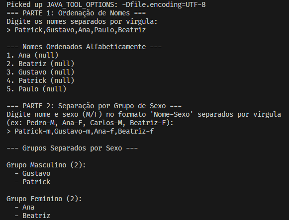

# Exercício EBAC Módulo 12

Neste exercício será feito em 2 partes, na 1ª parte o projeto deverá fazer o seguinte:

1. Leitura de nomes separado por virgulas no console
2. Separar esses nomes e guardar numa Coleção / Array
3. Fazer a ordenação desses nomes em ordem alfabetica
4. Exibir na tela o resultado

Após feito a 1ª parte do exercício, na 2ª parte do exercício deve fazer:

1. Leitura de nomes e sexo separados por virgula no console, nota, o nome e sexo são separados por um traço;
2. Separar esses nomes e sexos e guardar numa coleção / array;
3. Separar esses dados por grupos de sexo;
4. Exibir na tela o resultado;

## Tecnologias

- Java 11+
- Git
- VSCode

## Resultado

